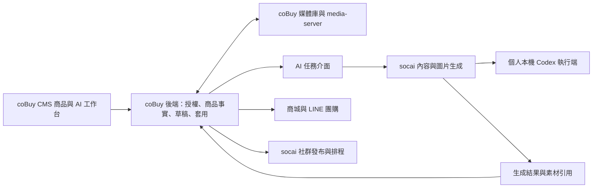

# coBuy 電商 AI 工作台整合建議

評估日期：2026-11-03（Asia/Taipei）。

本文件依 coBuySite、socai-media-ecommerce 與個人化 Codex Web 的現有程式整理。以下明確區分已存在的能力與建議新增的整合，並未修改這三套系統的業務程式、啟動 coBuy 正式服務或操作商品／訂單資料。

## 一、建議方向

以 **coBuy CMS 作為店家日常操作入口與正式商品資料來源**，將 AI 操作整合為商品編輯頁的側欄及可直接開啟的工作台。socai 提供內容生成、原生圖片與 FB／IG／Threads 發布能力；個人化 Codex Web 保留本機執行、檢查任務與用量的用途。使用者可以在 coBuy 完成上架與社群內容工作，AI 服務透過內部介面提供能力。

coBuy 沿用現有 React 19、React Router v7、Mantine 與 SWR；新增功能沿用既有 API wrapper、店別隔離與權限管理。

圖中跨系統 API、任務協定及回寫路徑為待建立的設計，不代表目前已互通。

## 二、已確認的現況

| 現況 | 程式證據 | 對整合的影響 |
| --- | --- | --- |
| Product 管理原料及庫存，Commodity 是銷售項目 | coBuy 的 README、Commodity 與 Productable 關聯 | 對外商品文案主體使用 Commodity，不把配方、成本或庫存資料任意輸出給顧客 |
| Commodity 已有名稱、代碼、售價、定價、分類、標籤、狀態、配方與備註 | Commodity entity 與 CreateCommodityDto | 可重用現有資料事實；完整銷售頁內容仍需獨立欄位或內容表 |
| 商品主圖仍是 HasOne Image，表單傳 imgFile，預覽讀 imgPath | CommodityFormModal、SharedImageAndTenantSelector、ImagesService | 新媒體庫尚未直接成為商品圖來源，需要相容轉接 |
| 已有 UUID 媒體庫、資料夾、標籤、分享、分段上傳與續傳 | MediaModule、CmsMediaPicker、useMediaUploadQueue、coBuy-media-server | 以 coBuy 媒體庫保存正式素材，其他服務傳回資產引用或受控圖片位元組 |
| CmsMediaPicker 已可上傳或選現有檔案，但目前為單選 | CmsMediaPicker 的 selectedAssetId 與 onSelect | AI 素材工作台可延伸多選與最多十個附件，仍走同一上傳佇列 |
| 商品新增表單預設 status=5，即啟用 | CommodityFormModal initialValues | AI 結果要先存草稿；不能把模型回覆直接當作新增且上架的命令 |
| coBuy 已有 LINE 商品推播、團購輪次、訂單 campaignId | line、group-buy-campaigns、TenantOrder | 優先延用既有團購與 LINE 執行流程 |
| socai 已有工作區商品、生成紀錄、社群發布及排程 | ProductsModule、AiModule、PostsModule、SchedulerModule | 保留其 AI 及 Meta 平台能力，不同步複製 coBuy 的商品主檔、庫存與訂單 |
| socai MarketingPlan.productId 外鍵目前指向自己的 products | marketing.entity 與 migration | coBuy commodityId 不能直接填進 socai 的 productId 欄位；需外部來源識別或已驗證的商品快照 |
| coBuy 的 axios timeout 為一小時 | axiosConfig.ts | 長 timeout 不等於任務持久化，仍要處理重整頁面、掉線、重試與額度等待 |

主要程式來源：

- [Commodity 資料模型](/Users/ice168-tony/Documents/my-file/projects/coBuySite/coBuy-backend/src/commodities/entities/commodity.entity.ts)
- [商品編輯表單](/Users/ice168-tony/Documents/my-file/projects/coBuySite/coBuy-client/app/routes/co-buy-cms/app/modules/product-management/commodities/components/CommodityFormModal.tsx)
- [共用媒體選擇器](/Users/ice168-tony/Documents/my-file/projects/coBuySite/coBuy-client/app/components/cobuy/CmsMediaPicker.tsx)
- [分段上傳與續傳服務](/Users/ice168-tony/Documents/my-file/projects/coBuySite/coBuy-backend/src/media/media-uploads.service.ts)
- [媒體讀取及預覽權限](/Users/ice168-tony/Documents/my-file/projects/coBuySite/coBuy-backend/src/media/media-assets.service.ts)
- [socai 行銷計畫](/Users/ice168-tony/Documents/my-file/projects/socai-media-ecommerce/apps/backend/src/marketing/marketing.entity.ts)

## 三、介面與日常工作流程

### 商品上架工作台

桌面採三區，窄螢幕改為切換面板：

| 區域 | 呈現內容 |
| --- | --- |
| 左側：本次工作資料 | 選定商家、商品、參考照片、供應商文件、品牌規範；每個來源可查看與移除 |
| 中央：可編輯成果 | 商品標題、賣點、詳情、FAQ、圖片排列、商城實際版型預覽、修改前後差異 |
| 右側：AI 協作 | 自然語言調整、常用功能、生成進度、待確認事項、模型與用量 |

商品內容、素材、社群文案與發布計畫應有可直接開啟的子路由，重整後可回到同一商品與草稿，沿用 `/cms/co-buy/app` 既有路由及授權。

一次上架工作建議分為：

1. 選既有 Commodity，或建立尚未上架的內容草稿。
2. 拖入／貼上圖片，或從媒體庫選取；顯示檔案、預覽、上傳進度與重複來源提示。
3. AI 讀取圖文，提出標題、賣點、詳情、FAQ、分類／標籤建議。
4. 事實分為「系統既有」「使用者已確認」「AI 待確認」。價格、尺寸、材質、優惠期限等未知資訊保持待確認，圖片推測不直接成為事實。
5. 使用者在中央編輯，勾選要採用的欄位，對照實際商城預覽。
6. 保存草稿；確認後由既有 coBuy API 套用，再依原有權限執行上架。
7. 用同一份已確認的商品事實建立社群貼文與圖片，避免重填價格與活動條件。

商品價格、定價、庫存連動模式與配方預設視為受控事實；AI 內容套用不直接修改這些 ERP 欄位。若要調整價格，另列明確提案並重新走商品驗證及使用者確認。

### 社群內容工作台

以商品／活動選取內容目標，再選平台與主題，例如新品介紹、使用情境、購買疑慮或開團提醒。產出應是可編輯的標題、內文、CTA、圖片與連結欄位，並可個別選用版本。

貼文預覽應呈現實際準備發出的圖片、文字、平台帳號、商品／團購連結及發布時間。AI 文字建議、使用者採用、排程成功與平台發布成功是不同狀態；發布成功需有平台實際結果。

LINE 沿用 coBuy 的商品推播與團購輪次。FB／IG／Threads 沿用 socai 的平台整合。發布前重新確認商品狀態、價格、活動期限、素材存取與權限。各通路各自記錄嘗試及結果，避免一個平台重試時重複發布其他已成功的平台。

## 四、必須先打通的資料接點

### 1. 商品內容與草稿

目前 `note` 為簡短備註，商城商品頁也直接呈現該欄位。整合時應區分公開商品說明與內部備註，並新增商品內容資料與 AI 草稿版本，分別保存：

- 商品簡介、賣點、詳情、規格、FAQ、SEO 與圖片替代文字。
- 商品原始版本／updatedAt、來源事實快照、來源資產 ID、生成批次 ID。
- AI 建議的欄位修改、使用者採用的欄位、套用者與套用時間。

套用時 coBuy 後端重新驗證 tenantId、商品擁有權、欄位與原始版本；版本已變更時先重新比對，避免覆寫其他人的修改。跨表套用使用 transaction。詳細描述若允許 HTML，要限制可接受內容並安全渲染。

### 2. 商品圖片與媒體庫

新增商品與 MediaAsset 的關聯，保存 assetId、角色、排序與替代文字，例如主圖、圖集、詳情圖與社群素材。原圖、AI 成品與發文使用紀錄分開標記，便於回溯。

先保留舊 imgPath 商品圖讀取相容，再讓新表單透過 CmsMediaPicker 選圖。不把會到期的簽章 URL 存成永久商品圖片；顯示及執行時重新換取合法存取方式。公開商城圖片與私人 AI 參考圖需有各自的存取規則。

AI 生成圖要透過 coBuy 已授權的上傳／完成流程存回媒體庫，取得 coBuy 的 UUID，再綁定商品。socai 的數字媒體 ID 與 coBuy 的 UUID 不可混用。

### 3. 跨系統識別與權限

coBuy 的 tenantId 與 socai 的 workspaceId 需建立明確的連線對應；來源以 sourceSystem、tenantId、commodityId 或 draftId 識別。第一次接入先傳經後端驗證的商品內容快照與已授權圖片，避免另做雙向商品主檔同步。

模型輸出只提出內容建議，不能自行決定 tenantId、資料存取範圍或呼叫任意商品 API。服務間使用受限的連線授權；瀏覽器不持有 Codex token。任務領取與結果回傳均驗證連線、任務 ID、店別及有效期。

## 五、生成任務與本機登入

建議建立任務型介面，建立後先回傳 jobId，由畫面訂閱或輪詢進度。每個步驟保存結果，供重整、重試及重新啟動後使用。

任務狀態至少區分等待、執行中、等待額度、需要確認、完成、失敗與取消。提供「繼續」「重試這一步」「停止」；若啟用自動恢復，要在恢復時重新確認來源版本、活動有效期與取消狀態。額度恢復後可接續生成草稿，發布仍使用已核定的發布規則。斷線且結果未知時，先依官方執行 ID 對帳，不能直接當成失敗而重複生成或發布。

個人本機階段可讓 coBuy、AI 服務及執行端在同一台主機／Docker 網路內協作。若 coBuy 位於雲端，個人本機執行端可透過已授權的對外連線領取個人任務；這段連線與任務協定目前尚未實作。

官方文件將本機／開源 app-server 驗證整合與商業／代管服務的授權方式區分。若將 AI 功能提供給多店家雲端服務，應採官方支援的 Sign in with ChatGPT 應用授權方案並確認資格與能力，不以目前的個人 CLI 登入憑證作為所有租戶的共用登入。

參考：[官方 Codex app-server 與驗證說明](https://learn.chatgpt.com/docs/app-server)、[Sign in with ChatGPT 開發者入口](https://developers.openai.com/siwc)。

## 六、實作順序與驗收

| 順序 | 範圍 | 驗收重點 |
| --- | --- | --- |
| 1 | 商品內容草稿＋媒體庫圖片關聯 | 舊商品正常顯示；新圖不用重新上傳；草稿不意外上架；跨店資產不可誤讀 |
| 2 | 單一商品 AI 側欄與結果套用 | 已確認商品資訊生成；逐欄編輯採用；重整不丟草稿；價格／配方不被自動改動；版本衝突可處理 |
| 3 | 同商品的社群文案與圖片 | 能產生及選用平台草稿；生成圖存回 coBuy 媒體庫；預覽可見實際圖片與正確商品連結 |
| 4 | 串接既有發布與任務恢復 | 各通路結果分開記錄；重試不重複發布；額度等待、取消、來源變更及過期活動有明確狀態 |
| 5 | 成效回流與批次功能 | 以訂單狀態與活動識別計算成交；補足點擊／UTM 事件後再呈現通路轉換率；同商品不同內容版本可比較 |

第一版優先完成「一個商品的素材 → AI 草稿 → 商城預覽 → 套用 → 社群草稿」完整流程，再擴充批次上架及自動化。

coBuy 已有團購 campaignId 與已付款訂單進度，可作為活動成效的起點。若要比較社群點擊到成交，還需新增連結事件、UTM 與訂單關聯；不能把目前的訂單統計稱為完整社群歸因，也不能只用生成次數表示成交提升。

## 七、本次評估邊界

已檢查商品模型／DTO／表單、媒體選擇器與上傳服務、LINE／團購接點、socai 的商品與行銷來源綁定及本機 Codex 執行介面。未執行共用資料庫、正式商品更新、社群發布、跨系統連線或 UI 視覺稽核。本文新增項目為實作建議，不能當成現有已完成能力。
